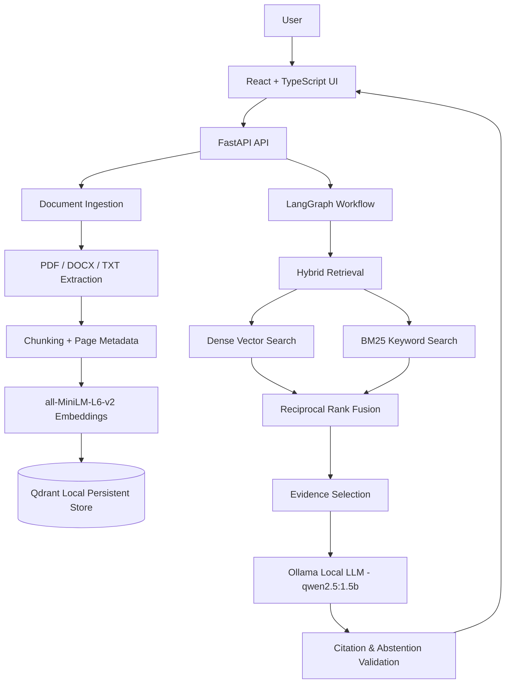

# DocuMind AI 🧠

> **Local-first document question-answering system with hybrid retrieval, Reciprocal Rank Fusion, LangGraph bounded workflows, and evidence-backed citations.**

DocuMind AI enables users to upload PDF, DOCX, and TXT documents, search across them, and receive grounded answers backed by verified source citations. Every response is strictly anchored in retrieved passages, preserving page numbers and document identities, and abstains when evidence is insufficient.

---

## 🌟 Key Features

- **Multi-Format Ingestion**: Extracts text and preserves page/section metadata from PDF, DOCX, and TXT files.
- **Persistent Local Vector Storage**: Uses local persistent [Qdrant](https://qdrant.tech/) and `sentence-transformers/all-MiniLM-L6-v2` embeddings that survive process restarts.
- **Hybrid Retrieval (Dense + BM25)**: Combines semantic vector similarity search with BM25 keyword matching to accurately match both conceptual queries and exact terms (names, codes, identifiers).
- **Reciprocal Rank Fusion (RRF)**: Merges disparate dense and keyword score distributions without manual score weight tuning ($k=60$).
- **Bounded LangGraph Workflow**: StateGraph governing question routing, hybrid retrieval, evidence sufficiency verification, grounded generation, and citation validation.
- **Local LLM Inference**: Fully private, local generation powered by [Ollama](https://ollama.com/) with `qwen2.5:1.5b`.
- **Verified Source Citations**: Every claim is linked to specific document passages and page numbers.
- **Graceful Abstention**: Explicitly refuses to hallucinate or guess when retrieved documents lack adequate evidence.
- **Evaluation Suite**: Reproducible benchmarks measuring latency, citation validity, and abstention accuracy.

---

## 🏗️ Architecture



---

## 📁 Repository Structure

```text
DocuMind-AI/
├── backend/
│   ├── app/
│   │   ├── main.py                  # FastAPI application entrypoint
│   │   ├── api/
│   │   │   └── routes.py            # API endpoints (health, upload, chat, documents)
│   │   ├── core/
│   │   │   └── config.py            # Pydantic configuration & environment settings
│   │   ├── ingestion/
│   │   │   ├── extractor.py         # PDF, DOCX, TXT text and page extractors
│   │   │   ├── chunker.py           # Overlapping chunker with metadata tracking
│   │   │   └── pipeline.py          # Orchestrated ingestion pipeline
│   │   ├── retrieval/
│   │   │   ├── vector_store.py      # Qdrant client & SentenceTransformer embeddings
│   │   │   ├── bm25_search.py       # BM25Okapi keyword index
│   │   │   ├── rrf.py               # Reciprocal Rank Fusion implementation
│   │   │   └── hybrid.py            # Hybrid dense + BM25 retriever
│   │   ├── agents/
│   │   │   └── graph.py             # LangGraph bounded research and QA workflow
│   │   └── generation/
│   │       ├── llm.py               # Ollama grounded generation client
│   │       ├── citations.py         # Citation verification & abstention detection
│   │       └── models.py            # Chat request & response schemas
│   ├── tests/                       # Unit & integration tests
│   └── requirements.txt             # Python dependencies
├── frontend/
│   ├── src/
│   │   ├── App.tsx                  # Interactive React UI with library & chat
│   │   ├── main.tsx
│   │   └── index.css                # Tailwind CSS
│   ├── package.json
│   └── vite.config.ts
├── evals/
│   ├── datasets/
│   │   └── sample_eval.json         # Labelled benchmark questions
│   └── run_eval.py                  # Evaluation benchmark runner
├── docs/
│   └── DocuMind_AI_Architecture_Workflows.md
├── docker-compose.yml
├── .env.example
├── .gitignore
└── README.md
```

---

## 🚀 Getting Started

### 1. Prerequisites
- **Python**: 3.10+
- **Node.js**: 18+ and npm
- **Ollama**: Installed and running locally ([Download Ollama](https://ollama.com/))

### 2. Pull the Local Model
```powershell
ollama pull qwen2.5:1.5b
```

### 3. Setup Backend
```powershell
# Create & activate virtual environment
python -m venv .venv
.\.venv\Scripts\Activate.ps1

# Install dependencies
pip install -r backend/requirements.txt

# Start backend API
python -m uvicorn backend.app.main:app --reload --port 8000
```
Backend health check is available at: [http://127.0.0.1:8000/health](http://127.0.0.1:8000/health)

### 4. Setup Frontend
```powershell
cd frontend
npm install
npm run dev
```
Open [http://localhost:5173](http://localhost:5173) in your browser.

---

## 📡 API Contract

| Method | Endpoint | Description |
|---|---|---|
| `GET` | `/health` | Service health status and indexed document count |
| `POST` | `/documents/upload` | Upload & index PDF, DOCX, or TXT file |
| `GET` | `/documents` | List all indexed documents and chunk statistics |
| `GET` | `/documents/{document_id}` | Retrieve details for a specific document |
| `DELETE` | `/documents/{document_id}` | Delete a document and its vectors from Qdrant |
| `POST` | `/chat` | Submit question to LangGraph hybrid QA agent |

### Sample Chat Request
```json
POST /chat
Content-Type: application/json

{
  "question": "What is the rank fusion algorithm used?",
  "document_ids": null,
  "top_k": 5
}
```

### Sample Grounded Response
```json
{
  "answer": "DocuMind AI uses Reciprocal Rank Fusion (RRF) to merge dense and keyword search results [Source: DocuMind_AI_Architecture_Workflows.md, Page: 1].",
  "insufficient_evidence": false,
  "sources": [
    {
      "document_id": "doc_9f8e21a",
      "filename": "DocuMind_AI_Architecture_Workflows.md",
      "page": 1,
      "chunk_id": "doc_9f8e21a_p1_c0",
      "snippet": "Reciprocal Rank Fusion (RRF) combines dense and keyword rankings..."
    }
  ]
}
```

---

## 📊 Running Evaluations

Run the automated evaluation benchmark:
```powershell
python evals/run_eval.py
```
This script computes:
- **Retrieval Hit Rate / Recall@K**
- **Abstention Accuracy** on out-of-scope questions
- **End-to-End Latency**
- Stores structured execution reports in `evals/reports/`.

---

## 🛡️ Security & Privacy
- **100% Local Inference**: Documents and embeddings remain stored locally in `./data/`.
- **Zero Cloud Leakage**: No user documents or queries are transmitted to external APIs.
- **Untrusted Input Sanitation**: Document contents are treated as untrusted context and strictly isolated from system instructions.

---

## 📄 License
MIT License.

