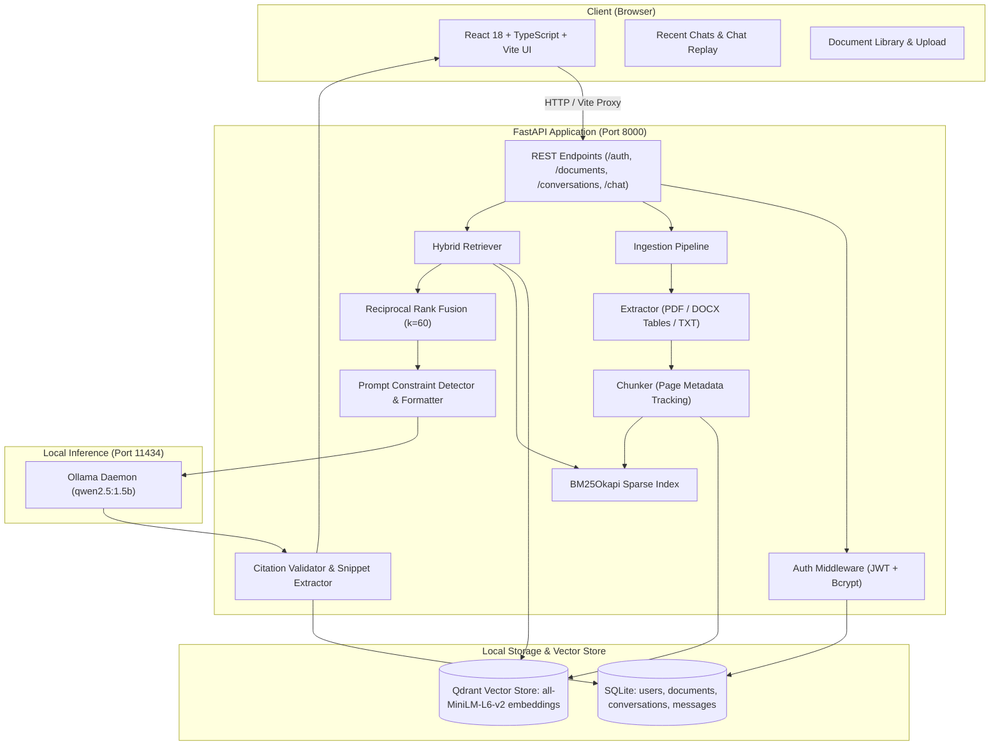

# DocuMind AI 🧠

> **Local-first, evidence-grounded Document Intelligence & RAG Assistant powered by FastAPI, React (TypeScript), hybrid dense-sparse retrieval (Qdrant + BM25), Reciprocal Rank Fusion (RRF), local Ollama inference (`qwen2.5:1.5b`), and verifiable citation validation.**

[](https://fastapi.tiangolo.com)
[](https://react.dev)
[](https://www.typescriptlang.org)
[](https://qdrant.tech)
[](https://ollama.com)
[](#-regression-testing--quality-evaluation)
[](LICENSE)

---

## 🌟 Key Highlights & Capabilities

- **100% Local & Private**: All document parsing, embeddings, vector indexing, and LLM text generation occur entirely on your local machine. Zero external API calls, zero telemetry, zero data leakage.
- **Robust Multi-Format Ingestion**:
  - **PDF**: Page-by-page text extraction with layout and physical page-number tracking.
  - **DOCX**: Extracts running paragraphs, styled headings, and structured data inside document tables (`docx.tables`).
  - **TXT**: Chunked with pagination preservation (50-line / char pagination) for uniform citation indexing.
  - **Resilience**: Corrupted, zero-byte, and empty documents are caught gracefully and reported with actionable diagnostics.
- **Hybrid Dense + Sparse Retrieval**:
  - **Dense Semantic Retrieval**: `sentence-transformers/all-MiniLM-L6-v2` embeddings indexed in persistent local [Qdrant](https://qdrant.tech/).
  - **Sparse Keyword Retrieval**: In-memory `BM25Okapi` index for precision matching on entity names, acronyms, and numeric IDs.
  - **Target Page Boosting**: Automatic detection and priority boosting when user prompts reference specific pages (e.g. `page 4`, `pg. 2`, `p. 5`).
- **Reciprocal Rank Fusion (RRF)**:
  - Fuses dense and sparse result distributions using rank-based reciprocal scoring ($k=60$) without requiring delicate score-threshold calibration.
- **Strict Formatting & Count Constraints**:
  - **Bullet Point Enforcement**: When the user requests an exact count (e.g., *"give me a summary in five bullet points"*), the engine guarantees exactly $N$ distinct bullets starting with `- `.
  - **Ordered Stage Extraction**: Extracts complex multi-stage pipelines in accurate 1-to-$N$ numbered sequence.
  - **Single-Sentence Bounds**: Restricts single-sentence requests to exactly one standalone sentence while preserving the trailing citation badge.
  - **Numbered Q&A Preservation**: Keeps multi-part test question sets structured rather than collapsing them into an unformatted summary paragraph.
- **Context-Centered Citation Grounding**:
  - Every factual claim links to the supporting source document and page number (`[Source: <filename>, Page: <page>]`).
  - Generates focused 180-character citation snippets centered around matching keywords in the source text.
  - Strictly prevents fabricated citations when answering that a detail is missing or unstated.
- **Faithful Abstention**:
  - If a metric or property is omitted from the document (e.g., measured accuracy, deployment URL, university ownership), the model explicitly states that it is not specified rather than hallucinating numbers.
- **User Authentication & Multi-Tenant Isolation**:
  - Secure JWT authentication with bcrypt password hashing (`/auth/signup`, `/auth/login`, `/auth/reset-password`).
  - Relational SQLite database with SQLAlchemy ORM enforcing strict user isolation across documents, conversations, and messages with foreign key cascade deletion.
- **Full Conversation History**:
  - Multi-session chat history with automatic titling, reopening previous chats, message replay, and conversation deletion.

---

## 🏗️ Architecture



---

## 📁 Repository Structure

```text
DocuMind-AI/
├── backend/
│   ├── app/
│   │   ├── main.py                     # FastAPI entrypoint, CORS, startup lifecycle
│   │   ├── api/
│   │   │   ├── routes.py               # Document & chat endpoints
│   │   │   ├── auth_routes.py          # Signup, login, password reset
│   │   │   └── conversation_routes.py  # Chat history, session management
│   │   ├── core/
│   │   │   ├── config.py               # Pydantic v2 application settings
│   │   │   ├── database.py             # SQLAlchemy engine & SQLite session
│   │   │   ├── security.py             # Passlib bcrypt & PyJWT token management
│   │   │   └── models_db.py            # User, Document, Conversation, Message ORM models
│   │   ├── ingestion/
│   │   │   ├── extractor.py            # PDF, DOCX (with tables), TXT extractors
│   │   │   ├── chunker.py              # Overlapping chunker with physical page tracking
│   │   │   └── pipeline.py             # Ingestion orchestration & vector indexing
│   │   ├── retrieval/
│   │   │   ├── vector_store.py         # Local persistent Qdrant client
│   │   │   ├── bm25_search.py          # BM25Okapi index with dual-key page support
│   │   │   ├── rrf.py                  # Reciprocal Rank Fusion implementation
│   │   │   └── hybrid.py               # Hybrid retriever & target-page regex booster
│   │   └── generation/
│   │       ├── llm.py                  # Grounded prompt builder, constraints, Ollama client
│   │       ├── citations.py            # Citation validator, centered snippet extractor
│   │       └── models.py               # Pydantic schemas for requests and responses
│   ├── tests/
│   │   ├── test_auth.py                # Authentication & JWT tokens
│   │   ├── test_auth_audit.py          # Multi-tenant isolation & cascades
│   │   ├── test_chat_history.py        # Conversation persistence & replay
│   │   ├── test_diagnostics.py         # Document health & limitation reports
│   │   ├── test_extraction.py          # PDF, DOCX tables, empty/corrupted files
│   │   ├── test_formatting.py          # Bullets, stages, single sentence, summaries
│   │   ├── test_rag_quality_eval.py    # Voice Shield evaluation benchmarks
│   │   └── test_retrieval.py           # Hybrid search, target pages, RRF fusion
│   └── requirements.txt                # Python dependencies
├── frontend/
│   ├── src/
│   │   ├── App.tsx                     # Main interactive application UI
│   │   ├── components/                 # Modals, sidebars, citations, message views
│   │   └── index.css                   # Tailwind styling & dark theme
│   ├── package.json
│   ├── vite.config.ts                  # Vite build configuration with backend proxy
│   └── tsconfig.json
├── data/
│   ├── sample_docs/                    # Benchmark sample documents
│   └── uploads/                        # User-uploaded files
├── docs/
│   └── DocuMind_AI_Architecture_Workflows.md # Detailed architectural specification
├── start_all.bat                       # One-click Windows startup script
├── start_all.ps1                       # One-click PowerShell startup script
├── run_tests.bat                       # One-click test suite runner
├── pytest.ini                          # Pytest configuration
└── README.md
```

---

## 🚀 Quick Start

### 1. Prerequisites
- **Python**: 3.10+ (Python 3.11 recommended)
- **Node.js**: 18+ and npm
- **Ollama**: Installed and running locally ([Download Ollama](https://ollama.com/))

### 2. Pull the Ollama LLM
```powershell
ollama pull qwen2.5:1.5b
```

### 3. One-Click Launch (Windows)
Run the root startup script to automatically launch the Ollama service, the FastAPI backend, and the Vite frontend in dedicated terminal windows:
```powershell
.\start_all.bat
```
*(Or in PowerShell: `.\start_all.ps1`)*

### 4. Manual Setup

#### Backend Setup
```powershell
# Create and activate virtual environment
python -m venv .venv
.\.venv\Scripts\Activate.ps1

# Install dependencies
pip install -r backend/requirements.txt

# Start FastAPI server on port 8000
python -m uvicorn backend.app.main:app --host 127.0.0.1 --port 8000
```
Backend health check: [http://127.0.0.1:8000/health](http://127.0.0.1:8000/health)

#### Frontend Setup
```powershell
cd frontend
npm install
npm run dev
```
Open [http://localhost:5173](http://localhost:5173) in your browser.

---

## 📡 API Reference

### Authentication Endpoints
| Method | Endpoint | Description |
|---|---|---|
| `POST` | `/auth/signup` | Register a new user account |
| `POST` | `/auth/login` | Authenticate with username/password and receive JWT token |
| `POST` | `/auth/reset-password` | Secure password reset endpoint |

### Document Endpoints
| Method | Endpoint | Description |
|---|---|---|
| `GET` | `/health` | Service health status, Ollama model, and indexed document count |
| `POST` | `/documents/upload` | Upload & index PDF, DOCX, or TXT file (multipart/form-data) |
| `GET` | `/documents` | List all documents belonging to the authenticated user |
| `GET` | `/documents/{id}` | Retrieve document metadata and chunk statistics |
| `DELETE` | `/documents/{id}` | Delete a document, its chunks, and associated vector embeddings |

### Conversation & Chat Endpoints
| Method | Endpoint | Description |
|---|---|---|
| `GET` | `/conversations` | List user conversation threads ordered by last updated |
| `POST` | `/conversations` | Create a new conversation thread |
| `GET` | `/conversations/{id}` | Retrieve conversation messages and state |
| `DELETE` | `/conversations/{id}` | Delete a conversation thread and its messages |
| `POST` | `/conversations/{id}/messages` | Append a message to an active conversation |
| `POST` | `/chat` | Submit question to hybrid RAG pipeline; returns grounded answer with citations |

---

## 🧪 Regression Testing & Quality Evaluation

DocuMind AI includes an automated regression test suite covering all modules:

```powershell
# Run the full regression test suite
.\run_tests.bat
```

### Verified Test Results (41/41 Passing)
```text
backend\tests\test_auth.py ..                                            [  4%]
backend\tests\test_auth_audit.py ....                                    [ 14%]
backend\tests\test_chat_history.py .                                     [ 17%]
backend\tests\test_diagnostics.py .                                      [ 19%]
backend\tests\test_extraction.py ........                                [ 39%]
backend\tests\test_formatting.py .........                               [ 60%]
backend\tests\test_rag_quality_eval.py ........                          [ 80%]
backend\tests\test_retrieval.py ........                                 [100%]

============================= 41 passed in 14.62s =============================
```

### Key Evaluated Scenarios:
1. **Initial Review Threshold**: Verifies that queries for initial threshold retrieve `0.75 or higher` and attach supporting citations with page numbers.
2. **Abstention on Unspecified Metrics**: Verifies that asking for unstated facts (e.g. measured accuracy, deployment URL, university name) responds with explicit non-hallucinatory abstention (*"The document does not specify the model's measured accuracy."*) with zero false fallback citations.
3. **Five-Bullet Summaries**: Guarantees exactly five bullet points covering purpose/audio specs, six processing stages, review threshold, evaluation benchmark, and key limitations (not proof of fraud, model errors, held-out validation).
4. **Ordered Six Stages**: Enforces full sequential order: `1. Audio input`, `2. Preprocessing`, `3. Feature extraction`, `4. Model scoring`, `5. Risk aggregation`, `6. Reviewer output`.
5. **Multi-Tenant Privacy**: Guarantees that users cannot access or query another user's documents or conversation threads.

---

## 🛡️ Security & Grounding Principles

1. **Untrusted Context Separation**: Uploaded document text is placed strictly within delimiter tags (`DOCUMENT CONTEXT`) and isolated from system directives to protect against prompt injection.
2. **Zero Fabrication Policy**: The model is prompted with zero-temperature bias and instructed to abstain whenever evidence is lacking.
3. **Log Sanitization**: Persistent application logs redact raw audio buffers, passwords, session tokens, and unnecessary PII.
4. **Data Isolation**: Foreign-key cascade rules ensure that deleting a user or document cleanly purges all related chunks, vector points, and conversation entries.

---

## 📄 License
This project is licensed under the [MIT License](LICENSE).
