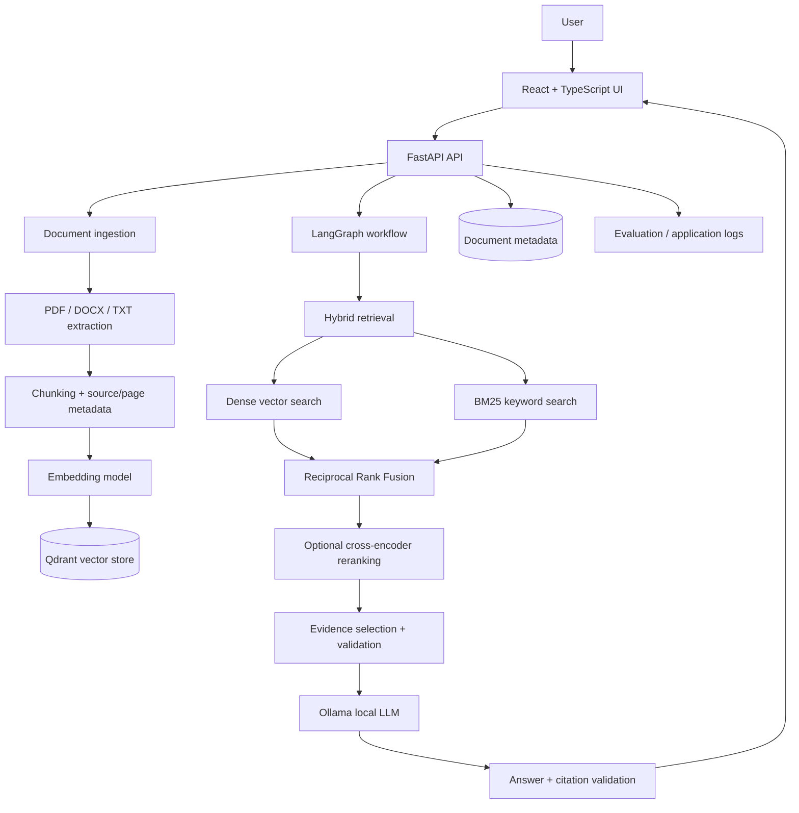
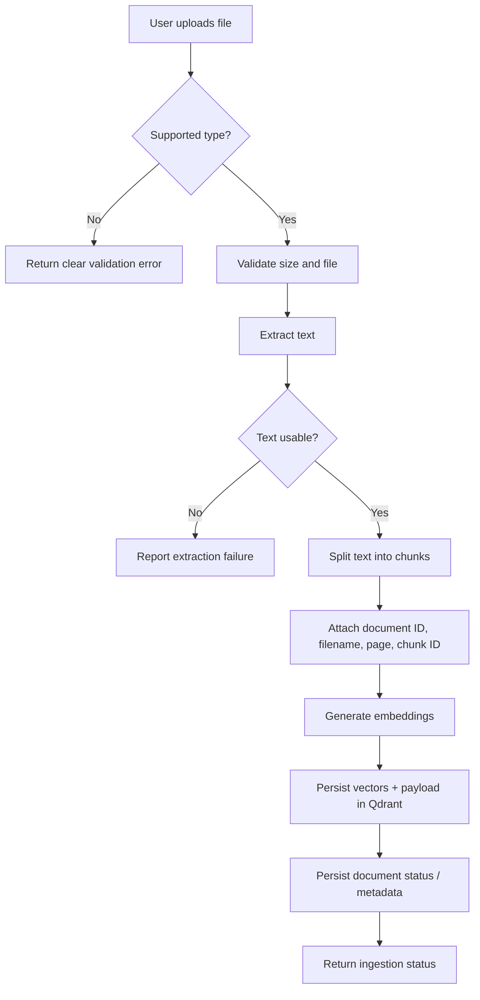
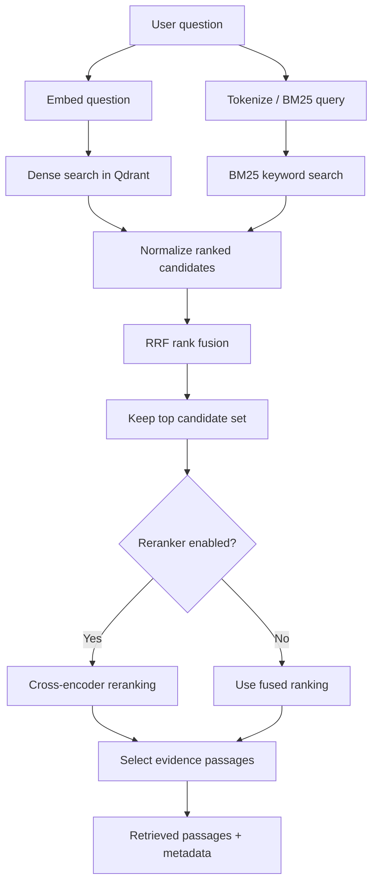
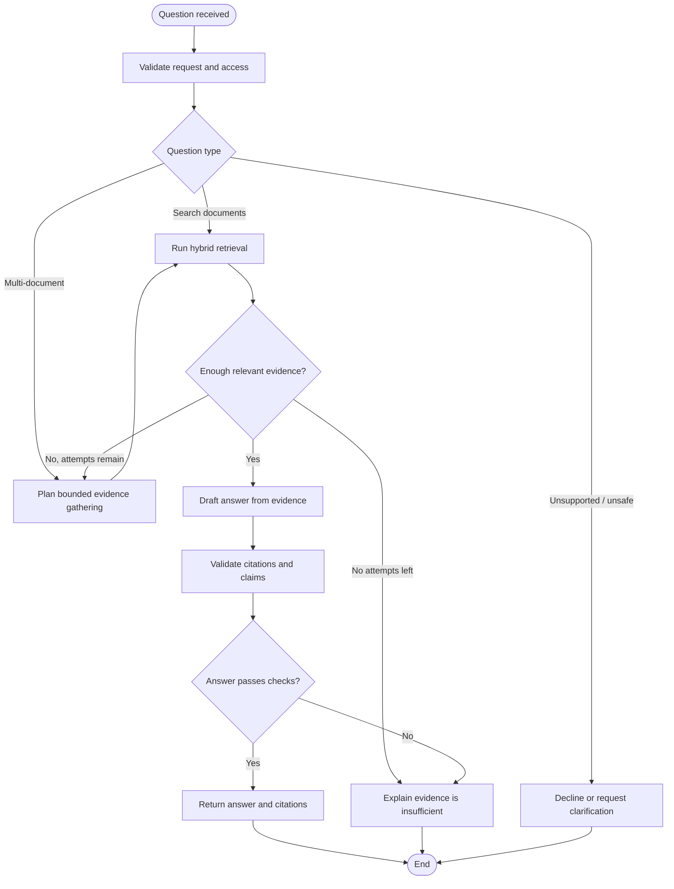
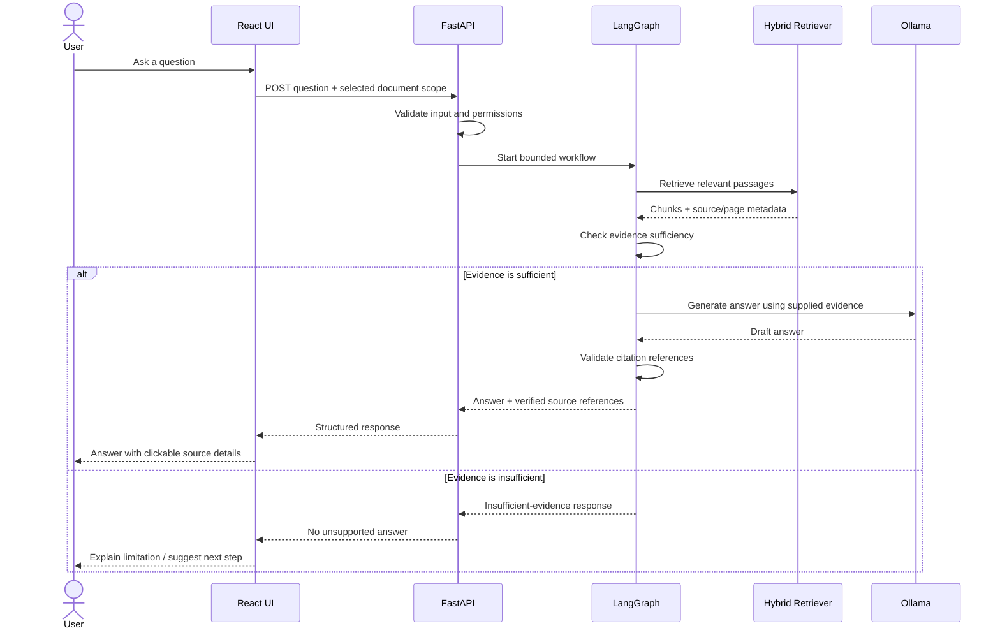
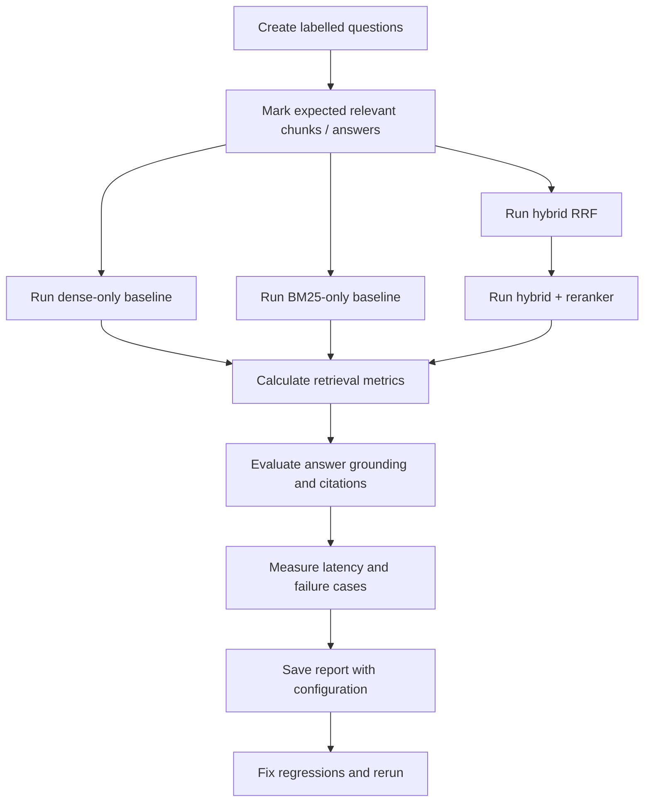
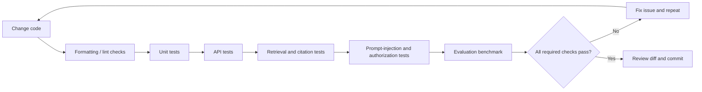
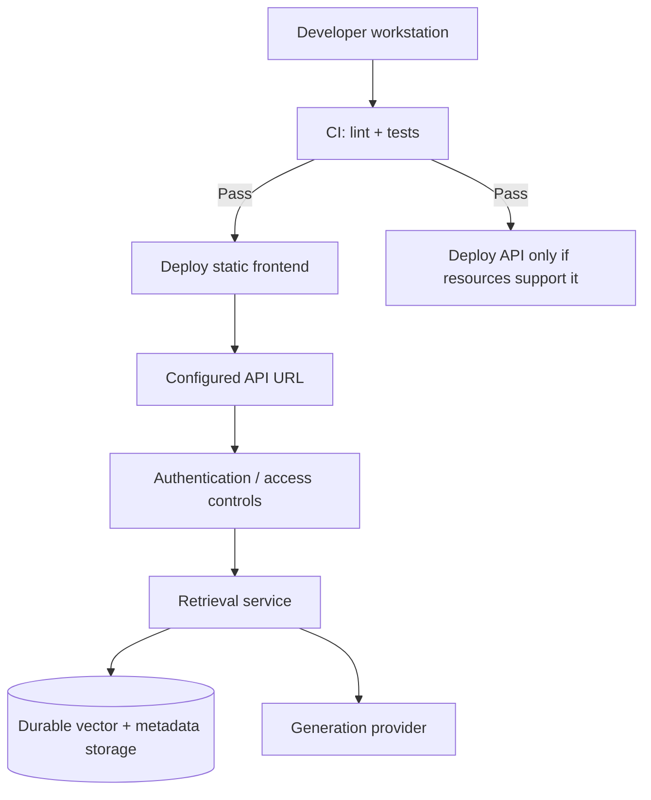

# DocuMind AI — Architecture, Workflows & Implementation Guide

> **Project goal:** Build a local-first RAG and agentic knowledge assistant that answers questions about uploaded documents with evidence-backed citations.
>
> **Status note:** The “completed” items below reflect the project checklist supplied by the developer. They have not been independently verified against the source code. The two remaining baseline items are called out explicitly.

---

## 1. Project at a Glance

DocuMind AI lets a user upload documents, ask questions across them, and receive answers grounded in retrieved passages. The application combines semantic retrieval with keyword search, fuses results using Reciprocal Rank Fusion (RRF), optionally reranks candidates, and uses a bounded LangGraph workflow to prepare a cited answer.

### Main goals

- Accept PDF, DOCX, and TXT documents.
- Preserve source identity and page metadata.
- Retrieve relevant passages using both meaning and exact keywords.
- Generate answers from retrieved evidence rather than unsupported model knowledge.
- Cite the source document and page where possible.
- Say when the available documents do not contain enough evidence.
- Keep local inference practical on a resource-constrained Windows machine.
- Evaluate retrieval and answer quality with a labelled dataset.

## 2. High-Level Architecture



**Design principle:** document ingestion and question answering are separate workflows. A document should be extracted, chunked, embedded, and indexed before it is used for semantic retrieval.

## 3. Suggested Repository Structure

```text
documind-ai/
├── frontend/
│   ├── src/
│   ├── public/
│   └── package.json
├── backend/
│   ├── app/
│   │   ├── main.py
│   │   ├── api/
│   │   ├── core/
│   │   ├── ingestion/
│   │   ├── retrieval/
│   │   ├── agents/
│   │   ├── generation/
│   │   └── evaluation/
│   └── requirements.txt
├── evals/
│   ├── datasets/
│   └── reports/
├── docs/
│   ├── ARCHITECTURE.md
│   └── WORKFLOWS.md
├── .github/
│   └── workflows/
│       └── ci.yml
├── .env.example
├── .gitignore
├── docker-compose.yml
└── README.md
```

Adapt this layout to the actual repository rather than moving or rewriting working code just to match the diagram.

## 4. Core Technology Choices

| Layer | Proposed technology | Responsibility |
|---|---|---|
| Frontend | React + TypeScript + Tailwind CSS | Chat, document library, upload status, citations |
| API | FastAPI + Pydantic | Request validation and API endpoints |
| Workflow orchestration | LangGraph | Routing, bounded research loops, final validation |
| Embeddings | `sentence-transformers/all-MiniLM-L6-v2` | Convert chunks and queries to vectors |
| Vector storage | Qdrant local persistent mode | Store vectors and chunk payloads |
| Keyword search | BM25 | Match exact names, terms, and identifiers |
| Fusion | Reciprocal Rank Fusion (RRF) | Combine dense and keyword rankings |
| Optional reranker | `cross-encoder/ms-marco-MiniLM-L-6-v2` | Reorder the strongest candidate passages |
| Local LLM | Ollama with `qwen2.5:1.5b` | Generate evidence-grounded answers |
| Testing | pytest + API tests | Validate behavior and prevent regressions |

Model names and dependency versions are configuration choices, not proof that a component is already wired into the app. Pin versions after the integrated project passes tests.

## 5. Workflow A — Document Ingestion

### Purpose

Turn an uploaded file into searchable chunks while retaining enough metadata to cite the original source.



### Recommended behavior

1. Validate the file type and maximum upload size.
2. Assign a stable document ID and record the original filename.
3. Extract text from PDF, DOCX, or TXT.
4. Preserve page numbers for PDFs when the parser provides them.
5. Split text into manageable, slightly overlapping chunks.
6. Store metadata with every chunk: `document_id`, `filename`, `chunk_id`, `page`, and any access-control owner ID.
7. Generate one embedding per chunk.
8. Persist vectors and payloads in Qdrant.
9. Report success only after the indexing operation succeeds.
10. Handle duplicate uploads and partial failures explicitly.

**Important:** the current checklist marks text extraction and chunking as complete, but embedding generation and persistent Qdrant storage remain unfinished. Do not mark ingestion as fully complete until those steps and their tests pass.

## 6. Workflow B — Hybrid Retrieval

Dense retrieval is good at semantic similarity. BM25 is useful for exact terms such as filenames, product codes, names, and error messages. Combining both can improve recall.



### Reciprocal Rank Fusion

RRF combines rankings without requiring the raw dense and BM25 scores to be on the same scale.

\[
\operatorname{RRF}(d)=\sum_{r \in R}\frac{1}{k+\operatorname{rank}_r(d)}
\]

- \(d\): candidate document or passage.
- \(R\): the set of ranked result lists, such as dense and BM25.
- \(\operatorname{rank}_r(d)\): the rank of candidate \(d\) in list \(r\).
- \(k\): a smoothing constant, commonly set to a value such as 60.

Deduplicate candidates by a stable chunk ID before sending them to the reranker or answer generator.

### Practical retrieval sequence

1. Retrieve a candidate set from Qdrant.
2. Retrieve a candidate set from BM25.
3. Merge and deduplicate both lists.
4. Apply RRF.
5. Optionally rerank the strongest candidates.
6. Return the selected passages with source and page metadata.
7. Measure retrieval quality against a labelled test dataset.

## 7. Workflow C — Agentic Question Answering with LangGraph

Use the agent for bounded routing and evidence gathering—not for an uncontrolled loop of repeated model calls.



### Guardrails

- Set a small maximum number of research steps, for example three.
- Keep tools read-only unless a specific write action is required.
- Apply document-level authorization before retrieval and before returning content.
- Treat uploaded text as untrusted data, not as instructions for the agent.
- Do not let a document override system policy or request secrets.
- Validate citations against passages actually retrieved for the current request.
- If the evidence is missing or contradictory, explain the limitation instead of inventing an answer.
- Log errors and timing without unnecessarily logging sensitive document contents.

## 8. Workflow D — Grounded Answer and Citations



### Suggested response shape

The exact schema should match the existing API, but a response can conceptually contain:

```json
{
  "answer": "The document states ...",
  "insufficient_evidence": false,
  "sources": [
    {
      "document_id": "doc_123",
      "filename": "policy.pdf",
      "page": 4,
      "chunk_id": "chunk_018"
    }
  ]
}
```

This is an illustrative schema only. Do not expose internal filesystem paths or other users' document identifiers. A citation should link to a real retrieved passage, not merely a filename invented by the model.

## 9. API Contract — Suggested Endpoints

Adapt endpoint names to the code that already exists.

| Method | Endpoint | Purpose |
|---|---|---|
| `GET` | `/health` | Basic service health |
| `POST` | `/documents/upload` | Upload and index a document |
| `GET` | `/documents` | List documents visible to the current user |
| `GET` | `/documents/{document_id}` | Retrieve status and metadata |
| `DELETE` | `/documents/{document_id}` | Delete a document and its indexed chunks, with authorization |
| `POST` | `/chat` | Ask a question and receive grounded answer + citations |

For `/chat`, validate the question, user identity or local-session scope, selected document IDs, and any request-size limits. Return clear error messages for missing documents, unavailable model service, failed indexing, and invalid input.

## 10. Evaluation Workflow

A project should demonstrate measured quality rather than claim “high accuracy” without evidence.



### Useful metrics

- **Recall@5:** whether a relevant passage appears among the top five results.
- **MRR:** how highly the first relevant passage is ranked.
- **Citation accuracy:** whether each citation points to evidence that supports its associated claim.
- **Faithfulness / groundedness:** whether the answer is supported by retrieved material.
- **Latency:** time for retrieval, generation, and total response.
- **Abstention quality:** whether the system refuses to guess when evidence is inadequate.

Start with 50–100 carefully labelled questions if practical. Include straightforward lookups, exact keyword questions, cross-document questions, unanswerable questions, and prompt-injection attempts. Record model names, retrieval settings, and dataset version for each report. **Never fabricate evaluation scores.**

## 11. Windows PowerShell — Local Setup

Commands below assume Windows PowerShell and that the tools are installed.

### Check prerequisites

```powershell
python --version
node --version
npm --version
git --version
ollama --version
```

### Create or enter the project

If the repository already exists locally, enter its directory instead of creating a second copy.

```powershell
mkdir documind-ai
cd documind-ai
git init
mkdir backend, docs, evals
mkdir evals\datasets, evals\reports
python -m venv .venv
```

Activate the virtual environment:

```powershell
.\.venv\Scripts\Activate.ps1
```

If PowerShell blocks activation, allow it for the current terminal process only:

```powershell
Set-ExecutionPolicy -Scope Process -ExecutionPolicy Bypass
.\.venv\Scripts\Activate.ps1
```

### Install backend dependencies

Use the repository's existing requirements file if present. A starting list may include:

```text
fastapi
uvicorn[standard]
python-multipart
pydantic-settings
httpx
pypdf
python-docx
sentence-transformers
qdrant-client
rank-bm25
langgraph
langchain-core
langchain-ollama
pytest
pytest-asyncio
```

Install from the file:

```powershell
python -m pip install --upgrade pip
pip install -r backend\requirements.txt
```

Only add or change dependencies after checking the existing imports and tests. Pin compatible versions after integration works.

### Install the local model

```powershell
ollama pull qwen2.5:1.5b
ollama run qwen2.5:1.5b
```

Keep Ollama bound to the local machine. Do not expose its port directly to the public internet.

### Start the API

The exact module path may differ in the existing code:

```powershell
uvicorn app.main:app --reload --app-dir backend
```

Check the health endpoint in a browser or with:

```powershell
Invoke-RestMethod http://127.0.0.1:8000/health
```

### Start the frontend

If the React app already exists:

```powershell
cd frontend
npm install
npm run dev
```

Follow the local URL printed by Vite.

## 12. Configuration and Secrets

A starting `.env.example` can look like this:

```dotenv
APP_ENV=development
OLLAMA_BASE_URL=http://127.0.0.1:11434
OLLAMA_MODEL=qwen2.5:1.5b
EMBEDDING_MODEL=sentence-transformers/all-MiniLM-L6-v2
QDRANT_PATH=./data/qdrant
UPLOAD_DIR=./data/uploads
MAX_UPLOAD_MB=10
RETRIEVAL_TOP_K=10
RERANK_TOP_K=5
MAX_AGENT_STEPS=3
```

Use the names that the application actually reads. Keep `.env`, uploaded documents, local vector data, model files, `.venv`, `node_modules`, and secrets out of Git.

Example `.gitignore` entries:

```gitignore
.env
.env.*
!.env.example
.venv/
__pycache__/
*.py[cod]
node_modules/
dist/
data/
uploads/
*.db
.pytest_cache/
.coverage
```

## 13. Testing Workflow



Suggested test groups:

1. **Ingestion:** supported formats, malformed files, empty text, size limits, page metadata.
2. **Vector persistence:** embeddings are created; vectors and payloads survive process restart.
3. **Retrieval:** dense, BM25, RRF fusion, deduplication, and optional reranking.
4. **Answering:** grounded responses, valid citations, insufficient-evidence behavior.
5. **Security:** document authorization, prompt injection, file validation, no cross-user leakage.
6. **API:** health, upload errors, missing IDs, model unavailable, malformed requests.
7. **Regression:** compare evaluation results before and after retrieval changes.

Run tests from the project root using the existing test configuration, for example:

```powershell
pytest -q
```

## 14. Deployment Strategy



### Local-first demo

- Run FastAPI, Qdrant local persistence, embeddings, and Ollama on the developer machine.
- Demonstrate uploads and grounded answers locally.
- Do not publish local document contents or credentials.

### Public portfolio demo

- A static frontend host can serve the React build.
- A public backend needs secure uploads, rate limits, authentication or isolated demo sessions, durable storage, and a generation provider that fits its resource limits.
- Free hosting services with very limited RAM or ephemeral disks are not suitable for running a local LLM and durable vector database together.
- If using a hosted model for the public demo, clearly document that it differs from local mode.
- Never expose Ollama or a private Qdrant instance directly to the internet.

## 15. Implementation Status Checklist

This section mirrors the checklist provided for the project; it is **not an independent code audit**.

### Milestone 1 — Working baseline

- [x] FastAPI app and `/health` endpoint
- [x] PDF, DOCX, and TXT text extraction
- [x] Chunking with source IDs and page metadata
- [ ] Generate embeddings and persist vectors in Qdrant
- [ ] Implement retrieval and a grounded-answer endpoint

### Milestone 2 — Advanced retrieval

- [x] BM25 keyword retrieval
- [x] RRF fusion of dense and keyword results
- [x] Optional cross-encoder reranking
- [x] Citation validation and insufficient-evidence behavior
- [x] Retrieval tests and comparison of configurations

### Milestone 3 — Agent workflows

- [x] LangGraph question-routing workflow
- [x] Document search and passage lookup tools
- [x] Bounded multi-document research loops
- [x] Evidence sufficiency checks and final answer validation
- [x] Prompt-injection, authorization, and loop-limit tests

### Milestone 4 — Portfolio and deployment

- [x] React chat and document-library UI
- [x] Source references and page numbers in the UI
- [x] API tests and labelled evaluation dataset
- [x] GitHub Actions, README, screenshots, and architecture diagram
- [x] Frontend and resource-appropriate public demo

### Next implementation order

1. Implement and test embedding generation.
2. Persist vectors and payload metadata in Qdrant.
3. Ensure retrieval can query the persisted collection after restart.
4. Connect retrieval to the grounded-answer endpoint.
5. Validate citations against retrieved chunks.
6. Test insufficient-evidence behavior, API errors, and end-to-end upload → question flows.
7. Re-run the labelled evaluation suite and update the README with only measured results.

## 16. GitHub Portfolio Presentation

A strong repository should include:

- A clear README with a short problem statement, features, architecture diagram, setup instructions, screenshots, and limitations.
- A short demo video or GIF showing upload → ask → cited answer.
- A small example dataset that contains no private information.
- Reproducible evaluation scripts and reports.
- A `.env.example` without secrets.
- CI that runs tests on each pull request.
- A license and a clear explanation of local versus hosted inference.
- Known limitations, including model resource needs and cases where the system abstains.

### Suggested README opening

> **DocuMind AI** is a local-first document question-answering system built with retrieval-augmented generation (RAG). It combines dense semantic search, BM25 keyword retrieval, Reciprocal Rank Fusion, optional reranking, and a bounded LangGraph workflow to produce answers with source references. The project emphasizes grounded answers, transparent citations, evaluation, and safe handling of uploaded content.

---

## 17. Definition of Done

Do not consider the core workflow complete until all of the following are demonstrated:

- [ ] A supported document can be uploaded and parsed.
- [ ] Chunks retain stable source and page metadata.
- [ ] Embeddings and Qdrant payloads persist successfully.
- [ ] A process restart does not erase indexed documents.
- [ ] A question retrieves relevant chunks through the intended retrieval path.
- [ ] The answer endpoint returns a structured answer and citations.
- [ ] Citations resolve to retrieved passages and their source metadata.
- [ ] Unanswerable questions result in a clear abstention rather than a guess.
- [ ] Authorization and prompt-injection tests pass.
- [ ] Evaluation results are generated from a labelled dataset and are reproducible.

**Keep the scope focused:** finish the two missing baseline tasks first, then verify the advanced features end-to-end. Preserve working code and avoid a full rewrite merely to match this document.
